<!--
  AeroCause README - PCCOE-IGC 2026 Hackathon Prototype
-->
<p align="center">
  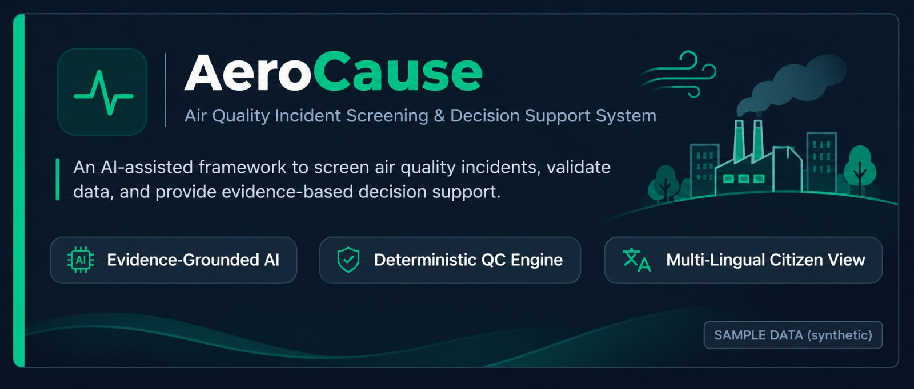
</p>

# AeroCause: From a pollution spike to an evidence-backed, cited, human-reviewed brief

[](./backend)
[](./ai-service)
[](./frontend)
[](./backend)
[](./ai-service)
[](LICENSE)

[The problem](#7-pm-the-pm25-line-jumps) · [What it does](#what-aerocause-does) · [Screens](#a-walk-through-the-app) · [How it works](#how-an-incident-travels) · [Source types](#how-it-decides-what-kind-of-source) · [Getting started](#getting-started) · [Limitations](#honest-limitations) · [Team](#the-team)

---

## 7 pm, the PM2.5 line jumps

It is a winter evening. At one monitoring station, the PM2.5 reading climbs well above its usual level for that hour. A dashboard shows the number. It does not say what to do next.

Whoever has to look into it asks a hard set of questions:
- **Is this real?** Or is the sensor stuck, drifting or broken?
- **What kind of source could this be?** Dust, traffic and combustion, biomass burning, industry, or just still air trapping what is already there?
- **What does the other evidence say?** Nearby stations, wind direction, other pollutants.
- **Which official guidance applies**, and what should be verified on the ground first?
- **Can I show my reasoning later?** To a colleague, a supervisor, or an audit.

**AeroCause** is an AI-assisted decision-support layer for air-quality incidents. It checks the reading, builds the evidence, ranks the types of source that fit, retrieves the relevant official guidance, and writes an officer brief in which every claim points back to evidence. When the evidence is not enough, it says **INCONCLUSIVE** and lists what would help.

It was built for **PCCOE-IGC 2026, Round 2 (Prototype Development)**.

> ⚠️ **What AeroCause is NOT:** It does not replace CPCB, MPCB or any monitoring system, and it does not claim to find "the" cause of pollution. It never names a specific factory, road or person. Final verification and enforcement stay with authorised humans.

---

## What already exists

Air-quality monitoring, AQI display, forecasting and source-apportionment research already exist in India and abroad, including government decision-support systems and academic work on AI and LLM-based attribution. AeroCause does not claim to be the first. Its angle is narrower: open data, an explicit separation of facts from hypotheses, cited guidance, an audit trail, and an honest "inconclusive" answer.

---

## What AeroCause does

| For officers | Under the hood |
| :--- | :--- |
| **Ingest** | Readings and weather for a chosen set of stations, with source and freshness shown. Provider interfaces, scheduled polling, raw payload storage, idempotent upserts. |
| **Check** | "Likely real event" or "suspected sensor fault" before anything else. QC rules: flatline, out-of-range, isolated spike, stale and missing data. |
| **Detect** | Incidents opened only for real deviations from the usual pattern. Hour-of-day baseline, robust z-score with MAD, minimum rise and persistence. |
| **Fingerprint** | A ranked list of source types, each with evidence for, evidence against and what is missing. Config-driven rules over pollutant ratios, co-pollutants, wind, upwind stations, stagnation. |
| **Explain** | A short, readable brief with uncertainty stated. An LLM that only sees a structured evidence package, plus a strict validator. |
| **Cite** | Recommended steps linked to the passage of an official document. RAG over a curated document set, with title, publisher and version. |
| **Review** | Accept, reject or ask for more evidence, with a comment. Reviews and audit events stored per incident. |
| **Inform** | A plain-language citizen page in English, Hindi and Marathi. Template-based summaries fed by the same evidence record. |
| **Replay and test** | Run a past episode through the same pipeline, and see a results table. Deterministic replay, backtest harness. |

---

## Four promises

- **Code computes the facts. The LLM only explains them.** Numbers, thresholds, rankings and hypotheses come from deterministic code. The model receives a structured evidence package and may not add facts.
- **A validator checks every brief.** Each evidence reference, number, citation and hypothesis in the text must exist in the input. If a brief fails twice, a template brief built from code is used instead, and the screen says so.
- **It can say "inconclusive".** If the top hypotheses are too close, or key inputs are missing, the result is `INCONCLUSIVE`, with a list of what extra evidence would settle it.
- **Nothing is hidden.** Measurement time, last fetch time, source, data-quality flags, the model mode (live or mock) and the validator result are all visible, and every step is written to an audit trail.

---

## A walk through the app

Every image below is a screenshot of the running app against the synthetic sample episodes in `data/`.

### Incident Desk & Operations
<table>
  <tr>
    <td width="50%">
      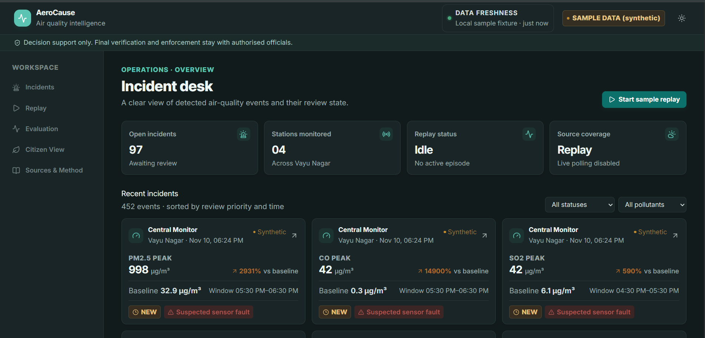
      <br/><b>Incident Desk:</b> Active incident feeds showing peak readings, status badges, and sensor fault QC chips.
    </td>
    <td width="50%">
      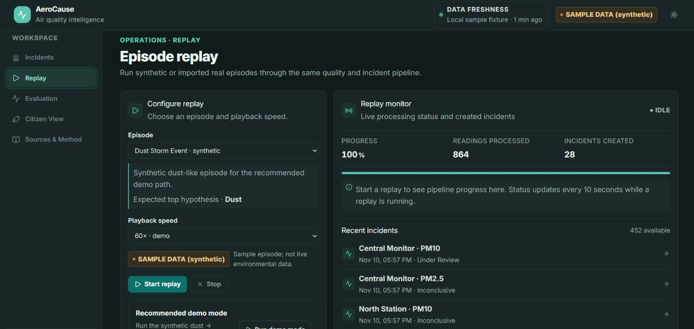
      <br/><b>Replay Mode:</b> Replaying historical or synthetic pollution episodes through the deterministic pipeline.
    </td>
  </tr>
</table>

### Incident Detail & Hypotheses Analysis
<table>
  <tr>
    <td width="50%">
      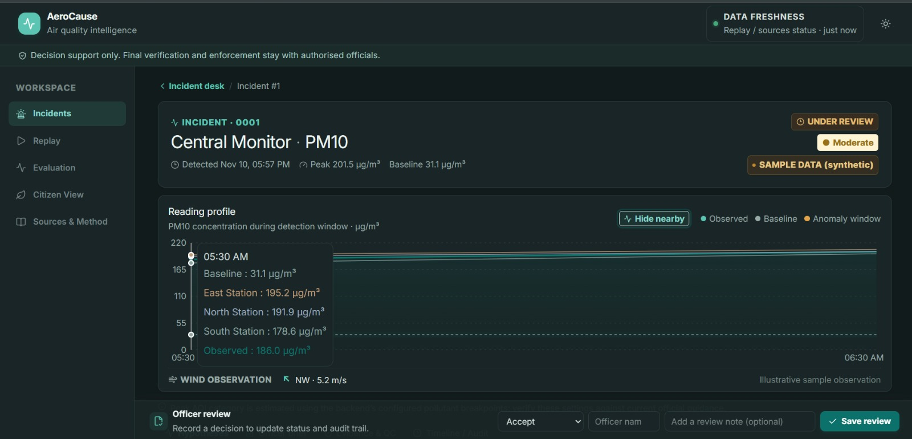
      <br/><b>Evidence Chart:</b> Sensor reading baseline band, anomaly window, and wind observation vector.
    </td>
    <td width="50%">
      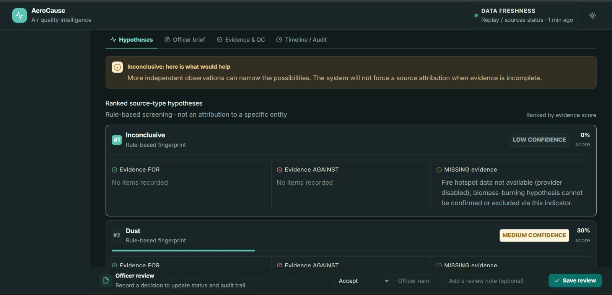
      <br/><b>Ranked Hypotheses:</b> Evidence breakdown (FOR, AGAINST, MISSING) for source attribution.
    </td>
  </tr>
  <tr>
    <td width="50%">
      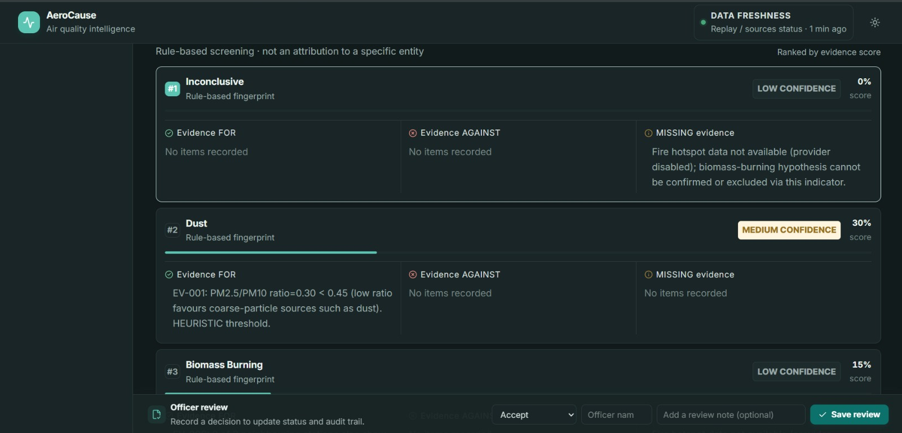
      <br/><b>Inconclusive State:</b> Explicit confidence boundary when parameters conflict or are missing.
    </td>
    <td width="50%">
      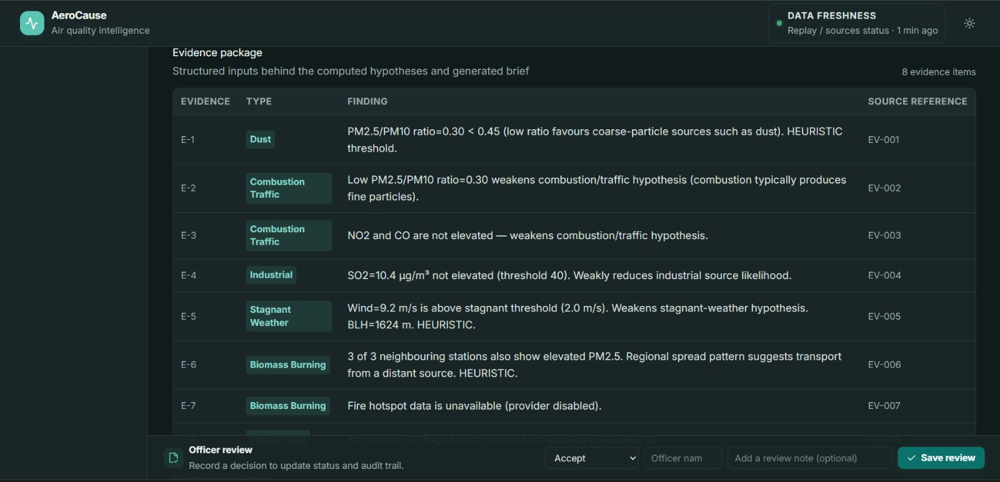
      <br/><b>Sensor Fault QC:</b> Isolation of hardware failures vs real environmental anomalies.
    </td>
  </tr>
</table>

### AI Brief, Citations & Governance Audit
<table>
  <tr>
    <td width="50%">
      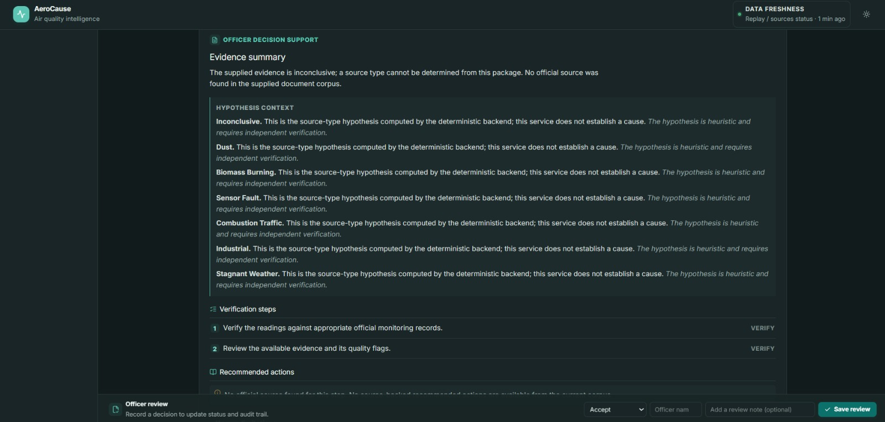
      <br/><b>Officer Brief:</b> LLM narration with side-over official document citation drawer.
    </td>
    <td width="50%">
      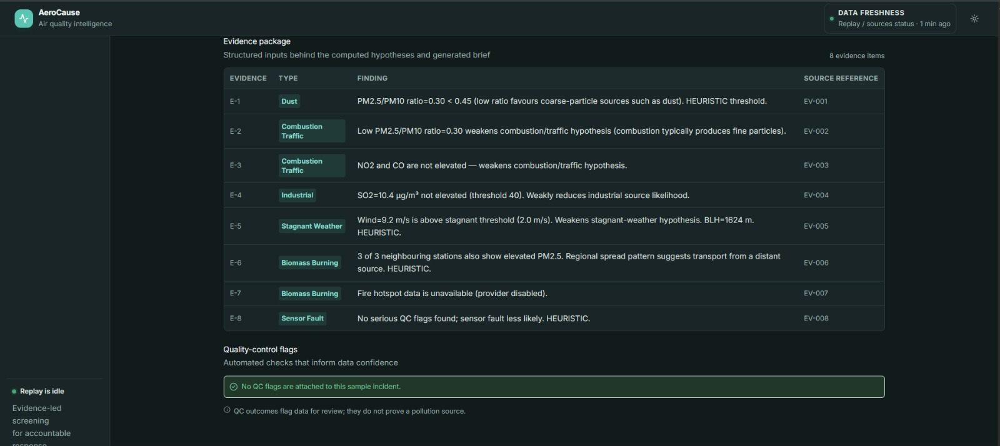
      <br/><b>Evidence & QC Tables:</b> Underlying raw data audit matrix verifying grounded claims.
    </td>
  </tr>
  <tr>
    <td width="50%">
      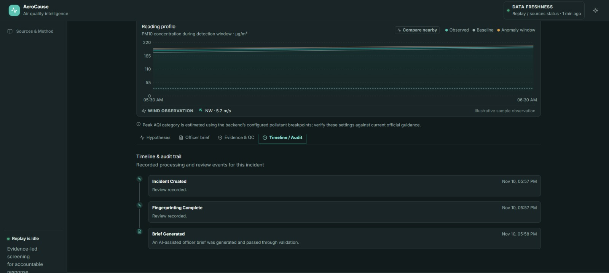
      <br/><b>Human Review & Audit:</b> Immutable decision review timeline for auditing officer actions.
    </td>
    <td width="50%">
      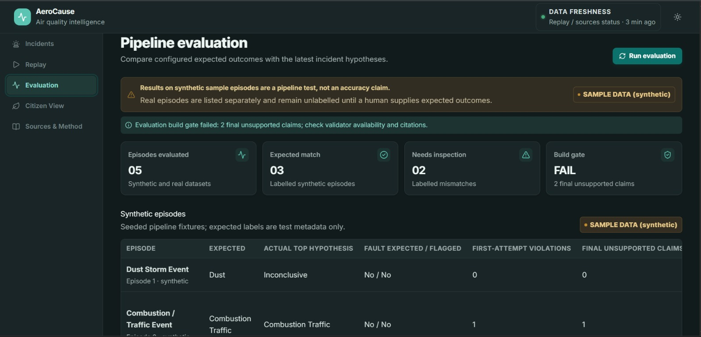
      <br/><b>Evaluation Harness:</b> Automated backtesting against synthetic test fixture ground truth.
    </td>
  </tr>
</table>

### Citizen View & Multi-Lingual Support
<table>
  <tr>
    <td width="50%">
      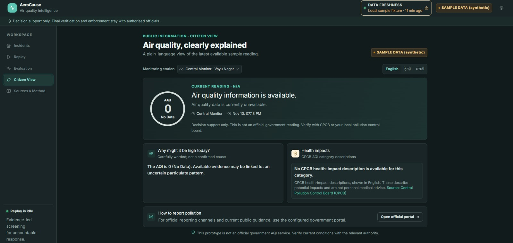
      <br/><b>Citizen View (English):</b> Clear public AQI metrics and plain-language health precautions.
    </td>
    <td width="50%">
      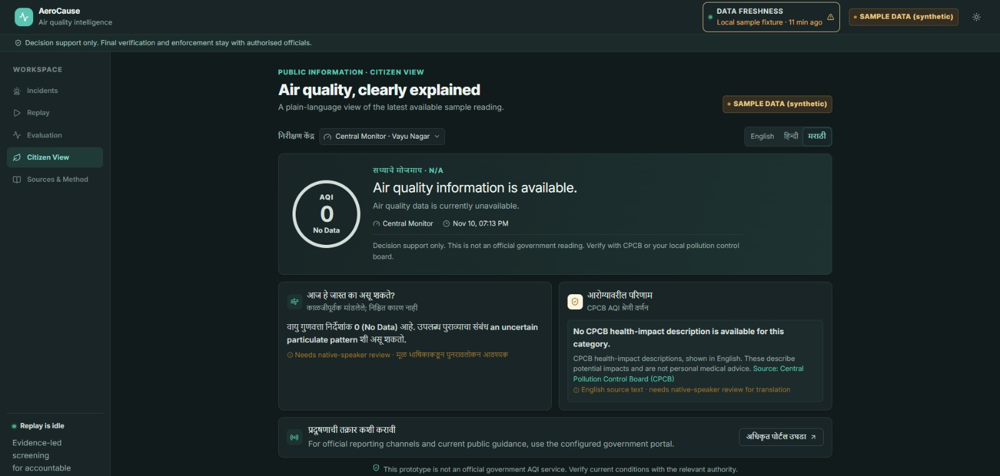
      <br/><b>Citizen View (Marathi / Hindi):</b> Instant template-based multi-lingual translations.
    </td>
  </tr>
  <tr>
    <td width="50%">
      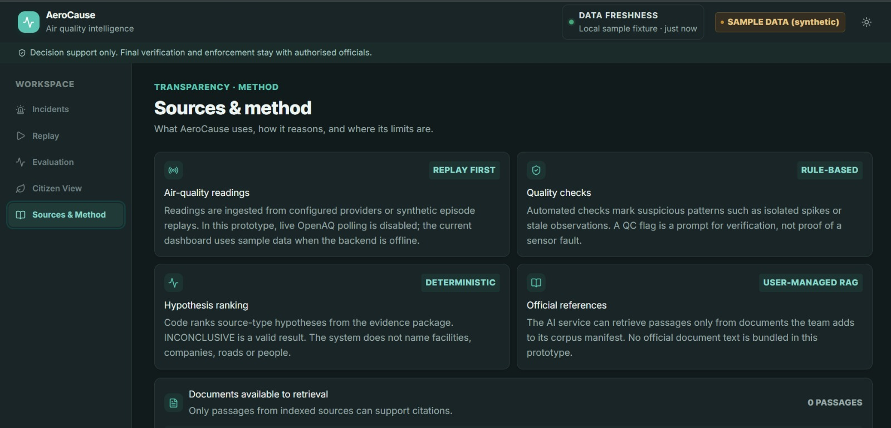
      <br/><b>Sources & Method:</b> Methodology transparency, data freshness, and policy claims.
    </td>
    <td width="50%">
      <div align="center">
        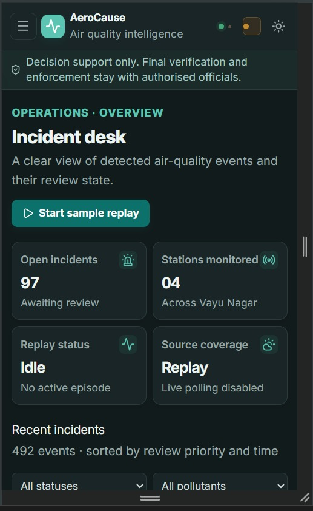
        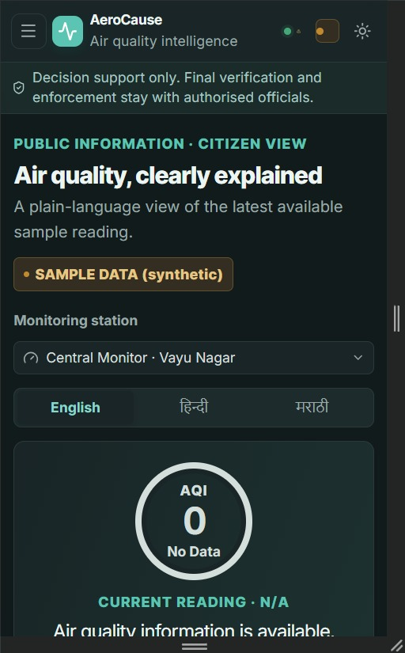
      </div>
      <br/><b>Mobile Viewports:</b> Fully responsive UI screens on mobile device widths (390px).
    </td>
  </tr>
</table>

---

## How an incident travels

```text
[ Data (live/replay) ] ──> [ QC Check (Real/Fault) ] ──> [ Anomaly Detection ]
                                                                  │
[ Audit Trail ] <── [ Officer Review ] <── [ Officer Brief ] <───┴──> [ Fingerprinting ]
                                                │                         │
                                      [ Validator Check ] <────── [ Evidence Package ]