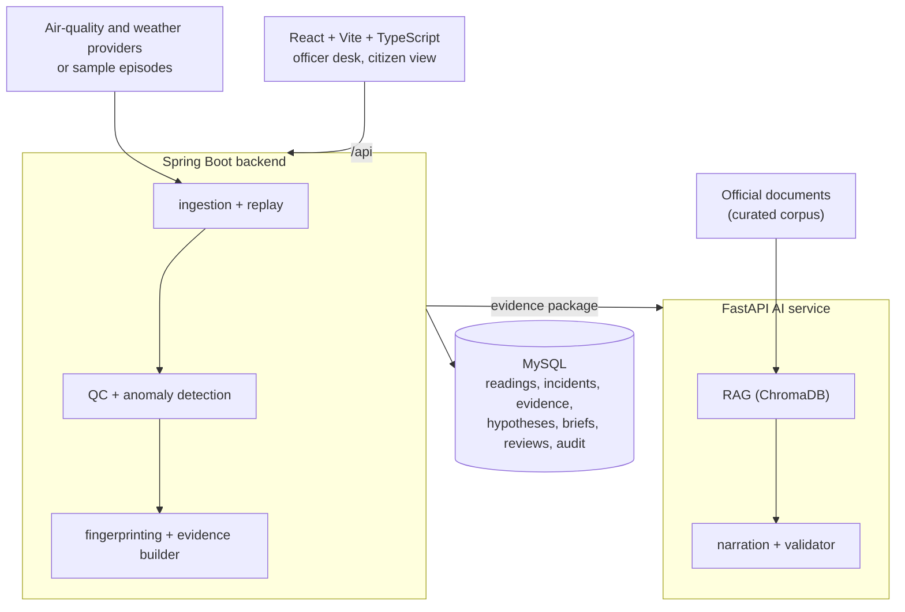

<!--
  AeroCause README - PCCOE-IGC 2026 Hackathon Prototype
-->
<p align="center">
  
</p>

# AeroCause: From a pollution spike to an evidence-backed, cited, human-reviewed brief

[](./backend)
[](./ai-service)
[](./frontend)
[](./backend)
[](./ai-service)

[The problem](#7-pm-the-pm25-line-jumps) · [What it does](#what-aerocause-does) · [Screens](#a-walk-through-the-app) · [How it works](#how-an-incident-travels) · [Source types](#how-it-decides-what-kind-of-source) · [Getting started](#getting-started) · [Limitations](#honest-limitations) · [Team](#the-team)

---

## 7 pm, the PM2.5 line jumps

It is a winter evening. At one monitoring station, the PM2.5 reading climbs well above its usual level for that hour. A dashboard shows the number. It does not say what to do next.

Whoever has to look into it asks a hard set of questions:
- **Is this real?** Or is the sensor stuck, drifting or broken?
- **What kind of source could this be?** Dust, traffic and combustion, biomass burning, industry, or just still air trapping what is already there?
- **What does the other evidence say?** Nearby stations, wind direction, other pollutants.
- **Which official guidance applies**, and what should be verified on the ground first?
- **Can I show my reasoning later?** To a colleague, a supervisor, or an audit.

**AeroCause** is an AI-assisted decision-support layer for air-quality incidents. It checks the reading, builds the evidence, ranks the types of source that fit, retrieves the relevant official guidance, and writes an officer brief in which every claim points back to evidence. When the evidence is not enough, it says **INCONCLUSIVE** and lists what would help.

It was built for **PCCOE-IGC 2026, Round 2 (Prototype Development)**.

> ⚠️ **What AeroCause is NOT:** It does not replace CPCB, MPCB or any monitoring system, and it does not claim to find "the" cause of pollution. It never names a specific factory, road or person. Final verification and enforcement stay with authorised humans.

---

## What already exists

Air-quality monitoring, AQI display, forecasting and source-apportionment research already exist in India and abroad, including government decision-support systems and academic work on AI and LLM-based attribution. AeroCause does not claim to be the first. Its angle is narrower: open data, an explicit separation of facts from hypotheses, cited guidance, an audit trail, and an honest "inconclusive" answer.

---

## What AeroCause does

| For officers | Under the hood |
| :--- | :--- |
| **Ingest** | Readings and weather for a chosen set of stations, with source and freshness shown. Provider interfaces, scheduled polling, raw payload storage, idempotent upserts. |
| **Check** | "Likely real event" or "suspected sensor fault" before anything else. QC rules: flatline, out-of-range, isolated spike, stale and missing data. |
| **Detect** | Incidents opened only for real deviations from the usual pattern. Hour-of-day baseline, robust z-score with MAD, minimum rise and persistence. |
| **Fingerprint** | A ranked list of source types, each with evidence for, evidence against and what is missing. Config-driven rules over pollutant ratios, co-pollutants, wind, upwind stations, stagnation. |
| **Explain** | A short, readable brief with uncertainty stated. An LLM that only sees a structured evidence package, plus a strict validator. |
| **Cite** | Recommended steps linked to the passage of an official document. RAG over a curated document set, with title, publisher and version. |
| **Review** | Accept, reject or ask for more evidence, with a comment. Reviews and audit events stored per incident. |
| **Inform** | A plain-language citizen page in English, Hindi and Marathi. Template-based summaries fed by the same evidence record. |
| **Replay and test** | Run a past episode through the same pipeline, and see a results table. Deterministic replay, backtest harness. |

---

## Four promises

- **Code computes the facts. The LLM only explains them.** Numbers, thresholds, rankings and hypotheses come from deterministic code. The model receives a structured evidence package and may not add facts.
- **A validator checks every brief.** Each evidence reference, number, citation and hypothesis in the text must exist in the input. If a brief fails twice, a template brief built from code is used instead, and the screen says so.
- **It can say "inconclusive".** If the top hypotheses are too close, or key inputs are missing, the result is `INCONCLUSIVE`, with a list of what extra evidence would settle it.
- **Nothing is hidden.** Measurement time, last fetch time, source, data-quality flags, the model mode (live or mock) and the validator result are all visible, and every step is written to an audit trail.

---

## A walk through the app

Every image below is a screenshot of the running app against the synthetic sample episodes in `data/`.

### Incident Desk & Operations
<table>
  <tr>
    <td width="50%">
      
      <br/><b>Incident Desk:</b> Active incident feeds showing peak readings, status badges, and sensor fault QC chips.
    </td>
    <td width="50%">
      
      <br/><b>Replay Mode:</b> Replaying historical or synthetic pollution episodes through the deterministic pipeline.
    </td>
  </tr>
</table>

### Incident Detail & Hypotheses Analysis
<table>
  <tr>
    <td width="50%">
      
      <br/><b>Evidence Chart:</b> Sensor reading baseline band, anomaly window, and wind observation vector.
    </td>
    <td width="50%">
      
      <br/><b>Ranked Hypotheses:</b> Evidence breakdown (FOR, AGAINST, MISSING) for source attribution.
    </td>
  </tr>
  <tr>
    <td width="50%">
      
      <br/><b>Inconclusive State:</b> Explicit confidence boundary when parameters conflict or are missing.
    </td>
    <td width="50%">
      
      <br/><b>Sensor Fault QC:</b> Isolation of hardware failures vs real environmental anomalies.
    </td>
  </tr>
</table>

### AI Brief, Citations & Governance Audit
<table>
  <tr>
    <td width="50%">
      
      <br/><b>Officer Brief:</b> LLM narration with side-over official document citation drawer.
    </td>
    <td width="50%">
      
      <br/><b>Evidence & QC Tables:</b> Underlying raw data audit matrix verifying grounded claims.
    </td>
  </tr>
  <tr>
    <td width="50%">
      
      <br/><b>Human Review & Audit:</b> Immutable decision review timeline for auditing officer actions.
    </td>
    <td width="50%">
      
      <br/><b>Evaluation Harness:</b> Automated backtesting against synthetic test fixture ground truth.
    </td>
  </tr>
</table>

### Citizen View & Multi-Lingual Support
<table>
  <tr>
    <td width="50%">
      
      <br/><b>Citizen View (English):</b> Clear public AQI metrics and plain-language health precautions.
    </td>
    <td width="50%">
      
      <br/><b>Citizen View (Marathi / Hindi):</b> Instant template-based multi-lingual translations.
    </td>
  </tr>
  <tr>
    <td width="50%">
      
      <br/><b>Sources & Method:</b> Methodology transparency, data freshness, and policy claims.
    </td>
    <td width="50%">
      <div align="center">
        
        
      </div>
      <br/><b>Mobile Viewports:</b> Fully responsive UI screens on mobile device widths (390px).
    </td>
  </tr>
</table>

---

## How an incident travels

```mermaid
flowchart TD
    D["Data (live / replay)"] --> Q["QC Check (real or fault?)"]
    Q --> A["Anomaly Detection (baseline + z-score)"]
    A --> I["Incident Opened"]
    I --> F["Fingerprinting (rules over evidence)"]
    F --> E["Evidence Package (JSON document)"]
    E --> R["AI Service (retrieve guidance)"]
    R --> L["LLM Narration (or mock mode)"]
    L --> V{"Validator"}
    V -- "passes" --> B["Officer Brief"]
    V -- "fails twice" --> T["Template Brief"]
    B --> O["Officer Review (accept / reject)"]
    T --> O
    O --> U["Audit Trail Log"]

### What happens when the model overreaches
 
```mermaid
sequenceDiagram
    participant BE as Backend
    participant AI as AI service
    participant LLM as LLM
    participant VAL as Validator
    BE->>AI: POST /investigate (evidence package)
    AI->>AI: retrieve passages from the corpus
    AI->>LLM: evidence + passages + strict rules
    LLM-->>AI: draft brief (JSON)
    AI->>VAL: check refs, numbers, citations, hypotheses
    VAL-->>AI: violation: number not in evidence
    AI->>LLM: retry once with the violations listed
    LLM-->>AI: second draft
    AI->>VAL: check again
    VAL-->>AI: passes (RETRIED) or fails (TEMPLATE_FALLBACK)
    AI-->>BE: brief + validator status + model mode
```
 
### Architecture
 

 
## How it decides what kind of source
 
The source types are: `SENSOR_FAULT`, `DUST`, `COMBUSTION_TRAFFIC`, `BIOMASS_BURNING`, `INDUSTRIAL`, `STAGNANT_WEATHER` and `INCONCLUSIVE`.
 
| Signal                                                   | What it favours                          |
|----------------------------------------------------------|------------------------------------------|
| PM2.5 to PM10 ratio low                                  | Dust                                     |
| PM2.5 to PM10 ratio high                                 | Combustion or secondary particles        |
| NO2 and/or CO elevated along with PM                     | Traffic or combustion                    |
| SO2 elevated                                             | Industrial                               |
| Wind direction, upwind against downwind stations         | Regional against local source            |
| Fire hotspots upwind (optional provider)                 | Biomass burning                          |
| Low wind, low mixing height, slow widespread rise        | Stagnant weather                         |
| One station off while neighbours stay normal, QC flags   | Sensor fault                             |
 
Each rule returns a signed contribution and a readable evidence string. When an input is not available, the rule adds a **missing evidence** note instead of guessing. The thresholds and weights live in configuration. **They are heuristics, not validated science**, and are meant to be tuned against real episodes.
 
## Data
 
- **Sample episodes (default).** `data/generate_sample_episodes.py` creates **synthetic** episodes for a small set of stations: a dust-like event, a combustion or traffic-like event, a biomass-burning-like event, a sensor fault, and one deliberately ambiguous case. They carry `synthetic = true`, and the UI shows a **SAMPLE DATA (synthetic)** badge wherever they appear.
- **Live providers (optional).** Air-quality and weather providers sit behind interfaces. Coverage, update delay and access terms depend on the provider, so check them before relying on live data.
- **Real episodes.** Put CSV exports in `data/real/` using the format in `data/README.md`. Real episodes are never labelled synthetic, and the evaluation page lists them separately.
- **Official documents.** The RAG corpus in `ai-service/corpus/` holds only documents you add, with a `manifest.json` (title, publisher, version, URL). Nothing is invented. If the corpus is empty, the app says "no official source found".
<!-- TODO: state which city / stations / date range you actually used for the demo. -->
 
## Getting started
 
You need **Docker**, and for local development also **Java 17**, **Python 3.11** and **Node 20+**. Commands are written for bash; on Windows use Git Bash or adapt the `export` lines for PowerShell.
 
<!-- TODO: verify every command and port below against the repo. -->
 
### Option A: run everything in Docker
 
**1. Clone and configure**
 
```bash
git clone <YOUR-REPO-URL>
cd <repo-folder>
cp .env.example .env
```
 
Open `.env` and set the database password. For the AI service, leave `LLM_PROVIDER=mock` to run without any key, or set `LLM_PROVIDER`, `LLM_API_KEY` and `LLM_MODEL` for a live model. Never commit `.env`.
 
**2. Start the stack**
 
```bash
docker compose up --build -d
```
 
This starts the database, the backend, the AI service and the frontend.
 
**3. Create the sample episodes**
 
```bash
python data/generate_sample_episodes.py
```
 
**4. (Optional) Add official documents for citations**
 
Copy documents into `ai-service/corpus/`, describe them in `ai-service/corpus/manifest.json`, then run the ingestion script described in `ai-service/README.md`. Without this step, briefs show no citations.
 
**5. Open it**
 
| What                          | Where                                                    |
|-------------------------------|----------------------------------------------------------|
| The app                       | [http://localhost:5173](http://localhost:5173)           |
| Backend API docs (OpenAPI)    | [http://localhost:8080/swagger-ui.html](http://localhost:8080/swagger-ui.html) |
| AI service docs               | [http://localhost:8000/docs](http://localhost:8000/docs) |
 
### Option B: run for development
 
```bash
docker compose up -d db                                   # only the database
 
# backend
cd backend && ./mvnw spring-boot:run                      # http://localhost:8080
 
# AI service
cd ai-service
python -m venv .venv && source .venv/bin/activate         # Windows: .venv\Scripts\activate
pip install -r requirements.txt
export LLM_PROVIDER=mock
uvicorn app.main:app --reload --port 8000
 
# frontend
cd frontend && npm ci && npm run dev
```
 
### A ten-minute tour
 
1. **Start a replay.** Open **Replay**, choose the dust-like episode, and press Start. Incidents appear on the **Incident desk**.
2. **Open the incident.** Look at the chart, the QC chip, and the **Hypotheses** tab. Compare evidence for, against and missing.
3. **Generate the brief.** Open **Officer Brief**. Check the validator and model-mode badges, and open a citation (if a corpus is loaded).
4. **Check the proof.** Open **Evidence & QC** and match the brief's claims to evidence items.
5. **Review.** Accept, reject or ask for more evidence, then open the **Timeline** to see the audit trail.
6. **Try the other episodes.** The sensor-fault episode should end in `SENSOR_FAULT`, and the ambiguous one in `INCONCLUSIVE`.
7. **Run the evaluation.** Open **Evaluation** and run the backtest.
8. **Open the citizen view** and switch languages.
### Troubleshooting
 
| Symptom                                   | Fix                                                                                                     |
|-------------------------------------------|---------------------------------------------------------------------------------------------------------|
| The incident desk is empty                | Start a replay first, or confirm the sample episodes were created.                                      |
| Briefs have no citations                  | The RAG corpus is empty. Add documents and a manifest, then run ingestion.                              |
| Briefs say `MOCK`                         | `LLM_PROVIDER=mock` is set. Set a live provider and key in `.env` to use a real model.                  |
| Validator shows `TEMPLATE_FALLBACK`       | The model's draft failed validation twice. This is expected behaviour, and the violations are logged.   |
| Port already in use                       | Change the port in `.env` or `docker-compose.yml`.                                                      |
| Live data is stale or missing             | Check the provider's coverage, keys and rate limits. The freshness chip shows the last successful fetch. |
 
## API
 
The full clickable contract is in the backend OpenAPI page. The main endpoints:
 
| Endpoint                                                                 | Purpose                                              |
|--------------------------------------------------------------------------|------------------------------------------------------|
| `GET /api/stations`, `GET /api/stations/{id}/readings`                   | Stations and readings                                |
| `GET /api/episodes`                                                      | Available sample and real episodes                   |
| `POST /api/replay/start`, `POST /api/replay/stop`, `GET /api/replay/status` | Run an episode through the pipeline               |
| `GET /api/incidents`                                                     | List incidents, filter by status                     |
| `GET /api/incidents/{id}`                                                | Full detail: evidence, hypotheses, brief, citations  |
| `POST /api/incidents/{id}/investigate`                                   | Generate the brief via the AI service                |
| `POST /api/incidents/{id}/review`                                        | Accept, reject or request more evidence              |
| `GET /api/incidents/{id}/audit`                                          | Audit timeline                                       |
| `GET /api/health/sources`                                                | Data freshness per source                            |
| `GET /api/citizen/aqi`                                                   | AQI summary for the citizen view                     |
| `POST /api/evaluation/run`, `GET /api/evaluation/latest`                 | Backtest and its results                             |
 
AI service: `POST /investigate`, `POST /citizen-summary`, `POST /retrieve` (debug) and `GET /health`.
 
## Working in this repo
 
```
backend/        Spring Boot: ingestion, replay, QC, anomaly detection, fingerprinting, REST API
ai-service/     FastAPI: retrieval (ChromaDB), narration, validator, mock mode
  corpus/       official documents you add + manifest.json
frontend/       React + Vite + TypeScript: officer desk, citizen view
data/           synthetic episode generator, CSV format notes, optional real data
docs/           architecture, API contract, demo script, limitations, screenshots
docker-compose.yml
.env.example
```
 
### Tests
 
```bash
# backend: QC, anomaly detection, fingerprint rules, AQI utility, replay integration
cd backend && ./mvnw test
 
# AI service: validator, retrieval, mock mode, schema
cd ai-service && pytest -q
 
# frontend
cd frontend && npm run lint && npm test && npm run build
```
 
<!-- TODO: add the real test counts here once you have run them. -->
 
### Working agreements
 
- Facts come from code. The LLM never decides a reading, threshold, regulation or cause.
- Never name a specific polluter in code, prompts, tests or UI text.
- Synthetic data is always labelled as synthetic.
- Official document text is never invented. Add real documents or show "no official source found".
- Thresholds and weights live in configuration, not in code.
- Never commit `.env`, keys or passwords.
## Honest limitations
 
- **Heuristic rules, not validated science.** The fingerprinting thresholds have not been calibrated against real, labelled incidents.
- **Types of source, not causes.** With readings and weather alone, the system cannot attribute a spike to a specific facility or activity, and it does not try to.
- **Synthetic evaluation.** Results on the sample episodes test the pipeline. They are not evidence of real-world accuracy or time saved.
- **Workflow not validated.** We have not yet confirmed with practising officers how they investigate incidents today.
- **Data dependence.** Freshness, coverage and access depend on the data provider. "Near real time" is the most we can say.
- **Translations need review.** Hindi and Marathi text is template-based and should be checked by native speakers.
- **Not an enforcement tool.** Decisions, inspections and enforcement stay with authorised humans.
## The team
 
Built by four students for PCCOE-IGC 2026, Round 2.
 
| Role                                 | Member | Focus                                                                  |
|--------------------------------------|--------|------------------------------------------------------------------------|
| **AI / LLM lead**                    | Soham  | RAG, prompts, narration, validator                                     |
| **Backend lead**                     | Ketaki | Ingestion, replay, QC, anomaly detection, fingerprinting, APIs, database |
| **Frontend lead**                    | Omkar  | Officer desk, evidence timeline, citizen view                          |
| **Product, QA and documentation**    | Shweta | Episodes and documents, testing, documentation, demo                   |
 
<!-- TODO: add surnames / roll numbers / links if you want them. -->
 
## Reference
 
- [Architecture](docs/architecture.md)
- [API contract](docs/api-contract.md)
- [Demo script](docs/demo-script.md)
- [Limitations](docs/limitations.md)
- [AI service notes](ai-service/README.md)
- [Data format](data/README.md)
