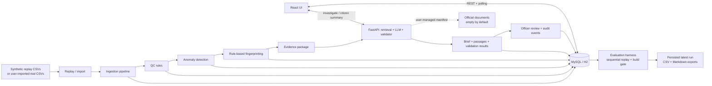

# AeroCause — Architecture

## Overview

AeroCause is a three-service monorepo. Services communicate over REST; the UI polls only while replay is active. The Spring Boot service persists episodes, incidents, audit events, briefs, and evaluation runs.

## Services

### Backend (Spring Boot 3 / Java 17)
- Ingestion: pulls from OpenAQ (live) or replays synthetic CSV data
- QC: applies quality-control rules, flags suspect readings
- Anomaly detection: MAD-based robust z-score over 14-day baselines
- Fingerprinting: rule-based source-type hypothesis scoring
- Evidence builder: assembles structured JSON for the AI service
- Evaluation harness: sequentially replays every configured episode, validates final briefs and citations, persists results, and exports CSV/Markdown reports
- Real CSV importer: imports `data/real/manifest.json` without synthetic or fabricated expected labels
- REST API: data access, replay control, review submission, and evaluation
- Storage: MySQL (prod) / H2 (dev)
- Flyway migrations for schema versioning

### AI Service (FastAPI / Python 3.11)
- RAG: user-managed PDF/TXT/MD documents listed in `/corpus/manifest.json`, chunked with page/section references and indexed in persisted ChromaDB
- Narration: deterministic MOCK provider by default or an OpenAI-compatible LIVE provider
- Validator: checks evidence and passage references, package hypothesis order, unsupported numbers, unverified proper nouns, uncited actions, and action-to-passage overlap
- Reliability: bounded HTTP retries with exponential backoff; failures are audited and exposed as stale provider status
- Fallback: one validator-guided retry followed by a deterministic template brief; first-attempt and final violations are reported separately
- Citizen summaries use language templates and only caller-supplied precaution text

### Frontend (React / Vite / TypeScript)
- Officer dashboard: incidents list, incident detail, review form
- Citizen page: safe, plain-language AQI explanation
- Evaluation page: episode replay results with expected vs actual
- All synthetic data labelled with "SAMPLE DATA (synthetic)" badge

## Data Flow

Evaluation replays each episode at a high deterministic speed, investigates its latest incident, counts first-attempt validator violations, verifies final-brief citations against retrieved passages, and requires zero final validator violations for the build gate. Real episodes with no human-supplied labels are listed separately and are not scored for expected-vs-actual accuracy.

## Key Design Decisions

| Decision | Rationale |
|----------|-----------|
| LLM explains; code decides | Prevents hallucinated thresholds or fake regulations |
| Mock LLM mode | Full demo without any API key |
| H2 dev profile | Instant startup; no DB server needed for dev/test |
| Idempotent upserts | Re-running ingestion is safe; raw payloads preserved |
| Config-driven thresholds | Heuristics can be tuned without code changes |
| INCONCLUSIVE is a valid answer | Prevents overconfident incorrect diagnoses |
| No specific entity naming | Only source TYPES — prevents defamation risk |
